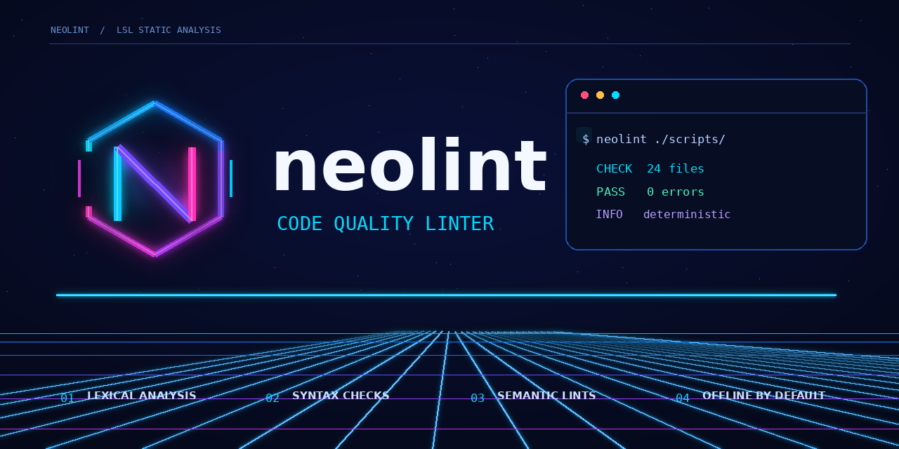

# neolint

<p align="center">
  
</p>

<p align="center">
  
</p>

A deterministic, offline-by-default CLI linter for Linden Scripting Language (LSL), written in Rust.

Neolint finds lexical, syntax, and conservative semantic problems before code reaches the official Second Life compiler. **It is not an LSL compiler and does not guarantee acceptance by Second Life or any simulator.** A clean result only means the implemented checks found no issue.

## Branding

Project logo, repository artwork, CLI icon, and the Windows executable icon are maintained in [`assets/branding/`](assets/branding/). The Windows release embeds `neolint.exe.ico` as its native application icon; Linux remains a console-only executable. The GitHub social preview artwork is [`assets/branding/neolint-social-preview.png`](assets/branding/neolint-social-preview.png).

## Status

- Current version: `1.1.0`.
- AST is the default analysis engine; `--engine legacy` selects the historical compatibility engine.
- `--engine compare` is available for maintainers.
- Diagnostic families: lexical (`LEX`), syntax (`PAR`), preprocessor (`PRE`), and semantic/lint (`SEM`).
- CLI-only: no GUI, TUI, web UI, IDE integration, language server, or autofix.
- Normal lint runs are deterministic and offline.
- Stable v1.1.0 is published: <https://github.com/mindwork64/neolint/releases/tag/v1.1.0>.
- Dual-licensed under **MIT OR Apache-2.0**.

## Supported release targets

The downloadable binary targets are Linux x86_64 and Windows x86_64. macOS, ARM, 32-bit, and other targets are not included in this release.

Versioned Linux and Windows archives are available from the [v1.1.0 release](https://github.com/mindwork64/neolint/releases/tag/v1.1.0). See [Getting started](docs/getting-started.md) for exact archive names, installation, and checksum verification.

## Quick start

```sh
neolint script.lsl
neolint --format json script.lsl
neolint ./scripts/
neolint --config .neolint.conf ./scripts/
neolint --disable SEM001,SEM004 ./scripts/
neolint --severity SEM004=warning script.lsl
neolint --engine legacy script.lsl
neolint --engine compare script.lsl
cat script.lsl | neolint -
```

Exit codes: `0` no error-severity diagnostics, `1` at least one error, `2` CLI/input/config error, `3` unmatched semantic comparison in `--engine compare` mode. Warnings and info diagnostics do not fail unless configured as errors.

## User documentation

- [Changelog](CHANGELOG.md)
- [Getting started and installation](docs/getting-started.md)
- [Command-line reference](docs/cli-reference.md)
- [Configuration](docs/configuration.md)
- [Diagnostic reference](docs/diagnostics.md)
- [LSL language support and limitations](docs/language-support.md)
- [Troubleshooting](docs/troubleshooting.md)

## Scope and limits

Neolint performs lexical, syntax, and selected semantic checks for LSL. Its rules favor issues that can be identified with confidence and avoid speculative findings for unknown extensions or unresolved values.

A clean result means only that no currently implemented rule reported an issue. It is not proof that the official compiler or a simulator will accept or correctly run the script.

## License

Neolint's own software source is available under either the [MIT License](LICENSE-MIT) or the [Apache License 2.0](LICENSE-APACHE), at your option.

Vendored Linden Research LSL definitions in `data/lsl-builtins.txt`, `data/lsl-deprecated.txt`, and the upstream notice at [`LICENSES/LINDEN-RESEARCH-MIT.txt`](LICENSES/LINDEN-RESEARCH-MIT.txt) retain their separate upstream MIT license. They are not relicensed by neolint's MIT OR Apache-2.0 choice. See [`data/README.md`](data/README.md) for provenance and attribution.
